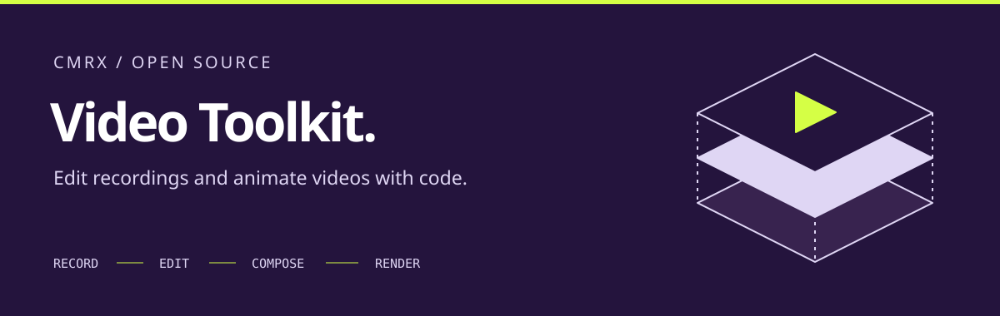

<p align="center">
  <a href="https://chrismarxdev.github.io/cmrx-video-toolkit/">Documentation</a> ·
  <a href="https://chrismarxdev.github.io/cmrx-video-toolkit/guides/quick-start/">Quick start</a> ·
  <a href="components/CATALOG.md">Components</a> ·
  <a href="https://cmrx.dev">Chris Marx Studio</a>
</p>

# CMRX Video Toolkit

Edit recordings through a transcript, add captions and Flutter animations, and
render videos with FFmpeg. The toolkit includes a browser editor, reusable video
components and skills that guide a coding agent through each stage.

You review the cuts and visual plan before the agent builds the animation. Your
recordings stay on your machine; you supply the colors, fonts and editorial direction.

Python + FFmpeg + Flutter · MIT licensed

## What’s inside

| Tool | What you can do |
| --- | --- |
| [Transcript editor](apps/editor/) | Review keep/cut ranges, add timed visual notes and export an agent handoff. |
| [Component browser](tools/component_browser/) | Explore real Flutter widgets, variants, props and motion. |
| [Video components](components/) | Compose with reusable widgets, shaders, media and deterministic motion. |
| [Dither tool](tools/dither/) | Explore local image/field dithering and export PNGs. |
| [Pipeline tools](scripts/) | Work with edit timelines, soundmaps, rendering and media checks. |
| [Agent skills](.skills/) | Give a coding agent instructions for editing, animation and review. |

## Get started

See the [external requirements inventory](docs/EXTERNAL-REQUIREMENTS.md) for the
minimum dependencies by workflow. Browser review does not need Flutter or Node;
the [MCP App / browser agent flow](apps/review-agent/README.md) adds agent handoff.

Install **Python 3**, **FFmpeg/ffprobe** and **Flutter** (tested with Flutter 3.47.2 /
Dart 3.13.2). Transcription requires a separate Whisper installation and model.

```sh
git clone https://github.com/ChrisMarxDev/cmrx-video-toolkit.git
cd cmrx-video-toolkit
python3 scripts/doctor.py
make components
```

Open **http://localhost:8090** to explore the component browser.

For the local Linux/macOS/Windows review app, follow its [setup instructions](apps/editor/README.md), then:

```sh
python3 apps/editor/server.py
```

[Read the full quick start →](https://chrismarxdev.github.io/cmrx-video-toolkit/guides/quick-start/)

## From recording to finished video

**Ingest → Transcribe → Edit → Storyboard → Compose → Review → Render**

Start with [video-flow](.skills/video-flow/SKILL.md). Review the rough cut before
detailed animation. Map source cues through the edited timeline; do not guess
animation timestamps. Keep recordings, transcripts, models and renders outside Git.

The toolkit is in early development and runs locally. Use the browser editor to
review cuts and visual notes; compose the video in Flutter. Native Scene GPU
capture currently uses a separate macOS path. Check the rendered video before
publishing.

## Set your video style

Use [video-style](.skills/video-style/SKILL.md) to define your direction through a
short interview and optional website, image or video references. It creates a
creator-owned folder with visual tokens, video rules, component recipes and
specimens for review. It can also refine an existing identity.

`components/` contains the `video_components` Flutter package. Styled widgets
require your own `VideoStyle`; the toolkit does not impose colors, fonts or
editorial presets. The CMRX colors on this README and documentation site style
those pages only.

Pin the toolkit as a Git submodule in a separate production workspace. Set
`CMRX_WORKSPACE` to your project root; optional `CMRX_COMPONENT_PACKAGE`,
`CMRX_COMPONENT_NAME` and `CMRX_TOKEN_CLASS` connect your own Flutter design package.

[Workspace integration →](https://chrismarxdev.github.io/cmrx-video-toolkit/guides/workspace/)

## Develop & contribute

Run `make test` from the repository root for the video tooling checks.
Read [development guidance](docs/DEVELOPMENT.md) and the relevant skill before editing.
Use synthetic examples and preserve source/output timing contracts.

For this Starlight documentation site (Node.js >=22.12):

```sh
npm --prefix docs ci
npm --prefix docs run dev
npm --prefix docs run build
```

GitHub Actions builds and publishes the docs to GitHub Pages on `main`. Reference
pages are generated from the existing app, component and pipeline documentation.

## License

Repository-authored software is [MIT licensed](LICENSE). Dependencies retain their
own licenses; see [THIRD_PARTY.md](THIRD_PARTY.md). No brand fonts, private recordings
or client materials are bundled.

Built by [Chris Marx Studio](https://cmrx.dev).
