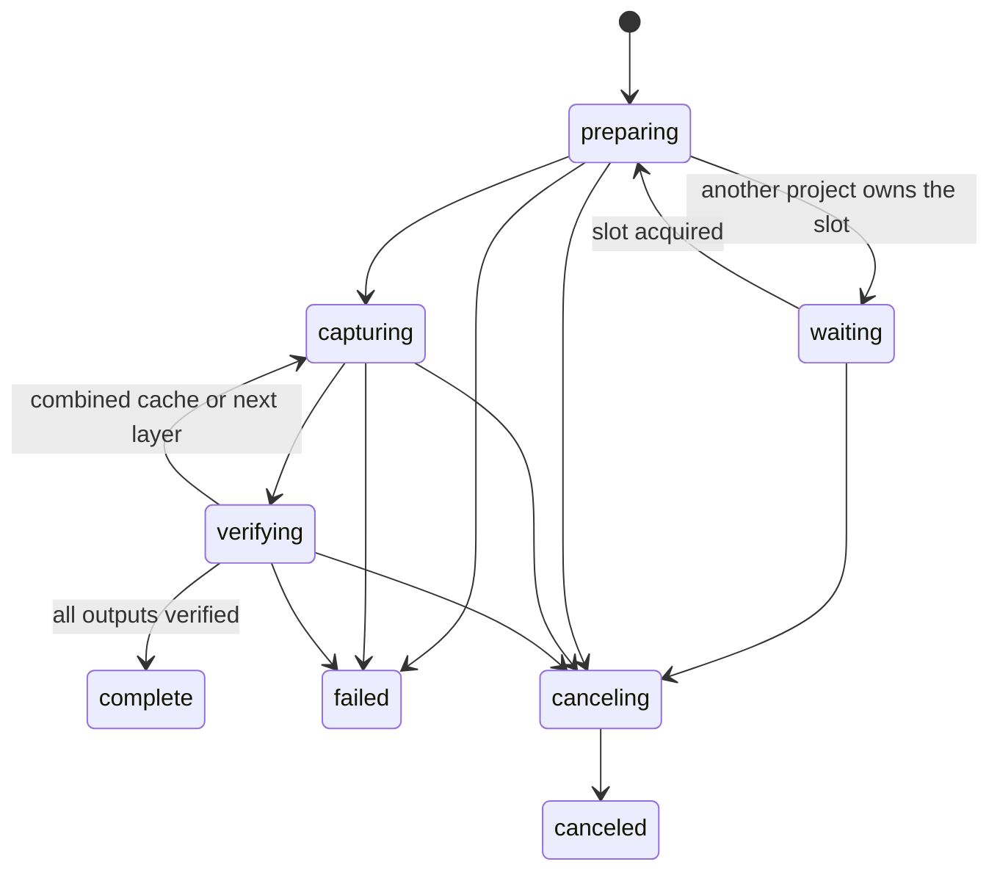

# App lifecycle and state-machine inventory

Scope: `apps/desktop/src` and its embedded `apps/local-editor/src`, including the
native shell, service, provider adapters, offline worker and browser renderer.
This is a source audit, not a claim of exhaustive dynamic verification. The old
Flutter review app is outside this desktop implementation.

## Decision

Use independent lifecycle owners plus a pure, versioned runtime projection.
Do not combine authentication, playback and rendering into a single global state,
or introduce a state-machine framework just to rename local booleans.

`src/project-runtime.mjs` supplies `runtime` to `/chat/state`, SSE and the agent's
`editor_context`. It describes connection, agent, preview and queue regions, an
exclusive timeline owner, user-facing status and capability reasons. The service's
lock predicate and runtime use the same `timelineOwner` function. Existing wire
flags and job statuses remain available. No persisted project schema changes.
The service still validates commands; UI capabilities are explanatory, not access
control. Preview-only layer toggles and seeking do not acquire timeline ownership.

Render jobs now expose a `phase` alongside their existing `status`:

An unfinished job restored after app restart is `interrupted`; it does not resume
silently. `track` is a zero-based progress ordinal, not a timeline track ID;
`trackCount` is the number of isolated graphics captures. No fabricated frame
percentage or estimated completion time. Earlier jobs without phases fall back
to `waitingForRender`/`status`. Verification does not weaken alpha/media checks.

## Inventory and ownership

Each row is a distinct transition boundary, including machines represented by
promises, maps, refs, file existence or generation counters rather than enums.
“Keep” means retain that existing authority, not that every edge is formally proved.

| Machine | Owner / source | States and events | Decision / important invariant |
| --- | --- | --- | --- |
| Desktop bootstrap and shutdown | `desktop.cjs`, `server.mjs` | starting → listening → closing; child exit/restart | Keep native process owner; cleanup waits on workers. Never restart user work to refresh UI. |
| Workspace selection | `workspace-library.mjs`, `desktop.cjs` | no workspace → chosen/created → selected; picker cancel | Keep file authority and canceled-picker no-op. Shared assets/skills stay workspace-scoped. |
| Project creation/open/recent | `project-library.mjs` | selected folder → validated → opened; missing/rejected | Keep path validation and stable identity; unrelated files are preserved. |
| Project tabs | `desktop.cjs`, `desktop-shell.js`, `desktop-session.mjs` | opening → active/background → closing/closed; restore | Keep independent service/agent ownership per project and persisted tab order. |
| Workspace lock | `server.mjs` | unowned → PID-owned → released; stale owner | Keep live-owner exclusion and dead-owner recovery. |
| Runtime download/install | `runtime-manager.mjs` | absent → downloading → verified → installed; cancel/failure/retry | Keep checksums/atomic installation and companion verification; installation is not sign-in. |
| Provider account connection | `provider-manager.mjs`, `settings-view.mjs` | disconnected → preparing/signing-in → connected; cancel/logout/failure | Keep explicit connection on each cold launch; expose connection region rather than inferring it from agent activity. |
| Provider/model selection | `provider-manager.mjs`, `server.mjs` | selected → switching → selected/failed | Keep guards on active/queued work; timeline ownership reports provider-switch. |
| Native agent turn | `codex.mjs`, `claude.mjs` | starting → active → stopping → completed/failed | Keep native thread/turn IDs and generation guards. Adapters retain provider-specific protocols. |
| Provider RPC correlation | `codex.mjs`, `tool-bridge.mjs` | requested → pending → response/timeout/closed | Keep bounded pending requests; do not turn timeout into a second invocation. |
| Timeline ownership | `server.mjs`, `project-runtime.mjs` | free / provider-switch / import / steering / agent / export | Consolidated lock predicate. Background graphics alone does not lock structural editing. |
| Tool dispatch | `server.mjs` | owning active provider → executing → result/error | Keep ownership check and revision validation. Context reads return immediately; long-poll render status separately. |
| Chat queue | `server.mjs`, `chat.js` | empty / paused / disconnected / waiting / ready → consumed | Keep durable FIFO and fresh context at execution. Stop/error/restart pauses, not discards, waiting work. |
| Queued steering | `server.mjs` | queued → delivery reserved → accepted/rejected | Explicit user action only. Remove on acknowledgement; preserve queue ID in history, reserve until acknowledgement, never create parallel turns. |
| Composer draft | `chat.js` | editing → submitting → accepted/rejected | Keep changed text and newly added attachments during delivery; clear only submitted payload after success. |
| Attachment upload | `chat.js`, `import-asset.mjs` | selected/pasted → uploading → imported/failed → attached/removed/sent | Keep original bytes and upload/send exclusion. Removal detaches, not deletes project media. |
| Streaming messages and scroll | `chat.js`, `message-view.mjs` | streaming item → appended/complete; follow/manual scroll | Keep item identity, safe Markdown and user's scroll position. No artifact player/download in chat. |
| Native video import | `server.mjs`, `import-video.mjs` | picker → probing/copying/converting → inserted; cancel/failure | Keep exclusive import ownership, aborts and source provenance; cancel picker leaves project unchanged. |
| Render slot scheduler | `desktop-session.mjs` | waiting ticket → slot acquired → released; cancel while waiting | Keep FIFO promises and abort-aware release. Distinct from whether the agent is busy. |
| Render job | `playground.mjs` | running phases → complete/failed/canceled/interrupted | Add observable phases; keep immutable snapshots, actual output verification and terminal statuses. |
| Graphics preview freshness | `playground.mjs`, service timer | missing/stale → render attempt → current/failure | Keep fingerprint and one attempt per fingerprint; report background activity independently of the agent. |
| Export download request | `chat.js` | user requested job → awaiting completion → downloaded/failed | Keep request-specific download once, never download an agent/background job automatically. |
| Direct-media render | `local-editor/src/render.ts` | created/running → complete/failed/cancelled/interrupted | Keep standalone renderer. Its legacy `cancelled` spelling remains wire-compatible. |
| Timeline transaction/history | `local-editor/src/workspace.ts` | current revision → validated edit → history branch; undo/redo | Keep revision-checked single writer and atomic files; undo moves history cursor without losing authority. |
| External project-file watch | `local-editor/src/workspace.ts`, `server.ts` | unchanged → changed → validate/reload/error | Keep invalid external content as an error, not a successful edit. |
| Editor connection | `local-editor/src/app.tsx` | connecting → snapshot/SSE connected → disconnected/reconnect | Keep connection separate from loaded state and active operations; stale UI cannot authorize edits. |
| Playback/seek | `app.tsx`, `clip-media.tsx` | paused/playing/seeking/ended; rate change, media readiness | Keep one playhead and native media readiness; playback is view state, not an export edit. |
| Media-preview cache | `media-preview.ts`, `clip-media.tsx` | absent → pending → cached/failed; shared pending promise | Keep keyed deduplication and native video load errors; avoid repeated thumbnail work. |
| Timeline gestures | `app.tsx`, `timeline.ts` | idle → press → scrub/pan/move/trim → commit/cancel | Keep local refs, pointer capture and draft patch; do not persist partial drags. |
| Space gesture | `app.tsx` | up → held-unused → held-pan-used → released | Keep tap-to-play vs hold-to-pan distinction, including cancellation. |
| Dock/layout resize | `dock-layout.tsx`, `app.tsx`, `chat.js` | idle → drag/keyboard resize → persisted view | Keep local bounded layout state and unified transparent handle styling. |
| Preview layer overrides | `app.tsx` | saved baseline ↔ local hide/mute override; reload resets | Keep view-only overrides usable during work; never write them into export state. |
| Timed comments | `comment-payload.mjs`, `app.tsx`, `server.mjs` | open → attached/reserved → acted on → resolved/reopened | Keep source/output anchors and snapshot validation. Resolve only verified completed work; edits/reopen create new work. |
| Asset library content | `asset-library.mjs` | discover → inspect/copy → independent project copy; promote/trash | Keep source provenance and path containment. Promotion is explicit; library updates do not mutate project copies. |
| Asset browser requests | `asset-manager.mjs` | scope/query/detail change → loading → latest response/error | Keep sequence guard against stale results and separate operation busy state. |
| Onboarding | `onboarding.mjs`, service onboarding routes | folder → account → video/empty → complete/dismissed | Keep persisted completion separate from connection; blank projects are valid. |
| Settings forms | `settings-view.mjs`, `agent-settings.mjs` | closed/editing → saving/pending → saved/error | Keep per-operation drafts and server guards; don't reinterpret a form's pending flag as project busy. |
| Secret availability | `secret-store.mjs` | absent → stored → injected/rotated/deleted | Keep keys device-bound and redacted; no secret material in runtime state. |
| MCP connection/session | `connections.mjs` | configured → connecting → connected/failed → disconnected | Keep session clients and key-rotation invalidation. Service hints do not authorize mutations. |
| External action approval | `project-agent.mjs` | proposed → awaiting approval → executing → complete/failed/unknown | Keep explicit approval and unknown-after-submission. Never equate cancellation with remote rollback. |
| Action recovery | `project-agent.mjs` | persisted running → unknown on restart | Keep no automatic replay of publishing/upload side effects. |
| Tool-document ticket | `project-agent.mjs`, `server.mjs` | created → opened → expired/revoked | Keep scoped read-only ticket, opaque sandbox and CSP; separate from app authentication. |

## Compatibility and validation

The explicit runtime projection is additive. Tests enumerate all 64 lock-flag
combinations and verify parallel preview/agent state, approvals, queues, legacy
render jobs, cancellation and failure labels. Existing integration/browser checks
remain the authority for actual commands, not capability labels alone.

Consumers should use `runtime.capabilities.<action>.allowed` and its stable reason
for diagnostics, and the versioned regions for orchestration. Do not poll a long
`editor_context` to wait for rendering: `editor_job` already provides bounded
long polling and now includes the job phase. Read context again after revisions.

Follow-up refactors should replace a lifecycle's booleans only when its own races,
recovery and cancellation behavior are covered. Centralizing all mutable state in
one store would couple unrelated regions, make background work block editing and
hide provider-specific recovery. Keep persisted schemas and native protocols stable
unless a migration is separately designed and tested.

Validation limits: browser fixtures exercise real service/UI transitions and media
transport; this audit did not rerun a full Flutter composition capture or macOS
native acceptance. The inventoried local machines are not all migrated or formally
verified. Native Linux onboarding and existing editing/connection/browser suites
passed; new pure/runtime-service tests check the shared state contract.

## Recorder ownership and persistence

The recorder is independent of timeline/agent ownership. One trusted native window
owns a fixed project. Renderer phases are setup → capture → saving → closed on success, with
interrupted/save-retry exits. The legacy complete section is only an interruption
recovery surface; successful captures have no completion screen. The setup popup
fits its source controls and shrinks to timer/Stop while recording. Device preflight is versioned; stale device enumeration
or permission results cannot replace a newer selection. Screen, camera and microphone
encode independently with bounded queued chunk IPC and approximate shared-clock offsets.

Main/store phases are setup → recording → saving → complete, or interrupted. Completed
bundles publish to assets only after all tracks remux/probe successfully; failures keep
staged partial sources. Close while recording requests stop/save. Quit waits for capture
save before closing services, with a timeout retaining partials. Reopening reconciles
abandoned PID-owned manifests and exposes their folder. No recorder phase edits or locks
project.json. Native OS/device acceptance is separate from synthetic encoder testing.
